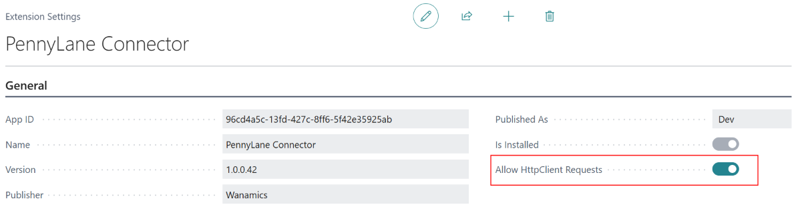
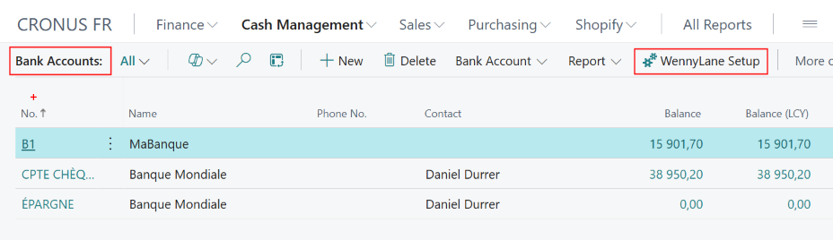
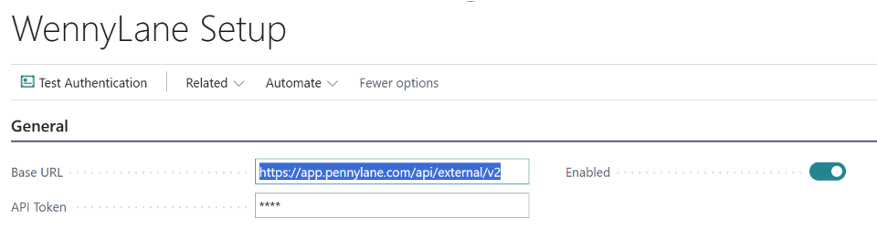
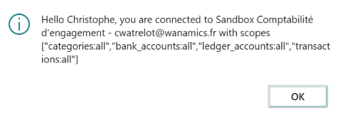

# Extension Wannylane

## Contexte
Si votre comptabilité est externalisée auprès d'un cabinet comptable, ce cernier vous a peut-être proposé de collaborer via [pennylane](www.pennylane.com).

**Pennylane** dispose en particulier d'un service d'agrégation bancaire. 

L'extension Wannylane permet d'intégrer ces transactions bancaires dans une **Feuille rapprochement** de Business Central.

## Prérequis

* Disposer d'une clé API (ou Token) pour chacune des sociétés avec les autorisation adéquates (voir [Générer un token Pennylane](./README_PennylaneToken.md))
* Avoir créé vos comptes bancaires dans Pennylane et établi les connexions aux banques concernées.

## Installation
Si ce n'est déjà fait, installez l'extension **Pennylane Connector** de Wanamics, et autorisez les requêtes http :

## Configuration

La configuration est propre à chaque société et doit donc être renouvellée pour chacune d'elles le cas échéant.

### Compte bancaires

Choisissez **Configuration Pennylane** et complétez la page comme suit&nbsp;:

|||
|:-|:-|
|Base URL|Elle est proposée et n'a pas lieu d'être modifiée.
|API Token|Collez le **Token API** généré ci-dessus par Pennylane
|Activé|Cochez cet indicateur
|||

Vous pouvez alors **Tester l'authentification** qui devrait afficher un message mentionnant la société et les autorisations accordées : 

Lier les compte bancaires

Depuis cette page de configuration, l'Action **Comptes Pennylane** permet d'associer chacun d'eux au **Compte bancaire** correspondant de Business Central.
Un compte bancaire Pennylane ne peut être lié qu'à un seul compte bancaire Business Central et réciproquement.
Seuls les comptes courants peuvent être liés. Les autres comptes (carte bancaire, épargne, crédit…) ne sont pas gérés via l'API.

### Planifier l'intégration des transactions
L'action **Planifier** permet de créer un traitement dans la **File d'attente de travaux**.
Veillez à ajuster l'heure du traitement pour qu'il soit postérieur à l'intégration des transactions dans Pennylane.

**Remarques**
* Renouvelez les tâches ci-dessus (Pennylane et Business Central) pour chacune des sociétés le cas échéant (un **Token API** est propre à une société).
* A l'issue de la **Période de validité** du token, vous devrez en créer un nouveau et le répercuter sur la **Configuration Wannylane**.

## Feuille rapprochement

L'action **Importer transactions Pennylane** créé une feuille pour chacun des comptes bancaires liés mouvementé depuis le dernier traitement.

## Modèle de données

### Tables étendues

|||||
|:-|:-|:-|:-
|273|Bank Acc. Reconciliation|+**Wannylane Timestamp**|DateTime
|275|Bank Account Statement|+**Wannylane Timestamp**| DateTime
|270|Bank Account|+**Wannylane Bank Account ID**| BigInteger
|||

### Tables ajoutées

|||
|:-|:-|
87430|Wannylane Setup|	
87431|Wannylane Bank Account Proxy
87432|Wannylane Transaction Proxy
87435|Wannylane Bank Establ. Proxy
87436|Wannylane Category Proxy
|||

### Enumération étendues
n/s

### Enumérations ajoutées
n/s

## A revoir
    * La liste des établissement bancaires ('/establishments") retourne une erreur (Forbidden (403)
    /bank_establishments : {"status":403,"error":"Access to this resource requires scope \"bank_establishments:readonly\"."}
    * Comment retrouver l'IBAN via l'API ?
    * Pourquoi les comptes cartes ne peuvent-ils être connectés ?
    * Dissocier les fonctions communes de l'interface / implementation (Bridgeapi, Pennylane)