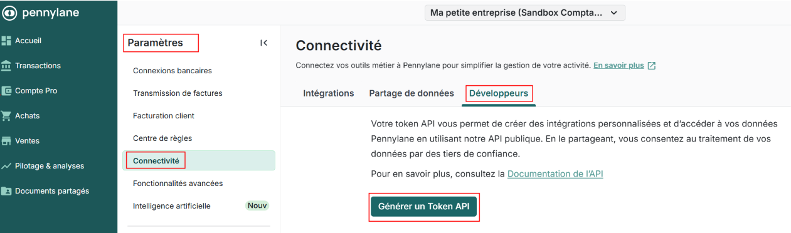
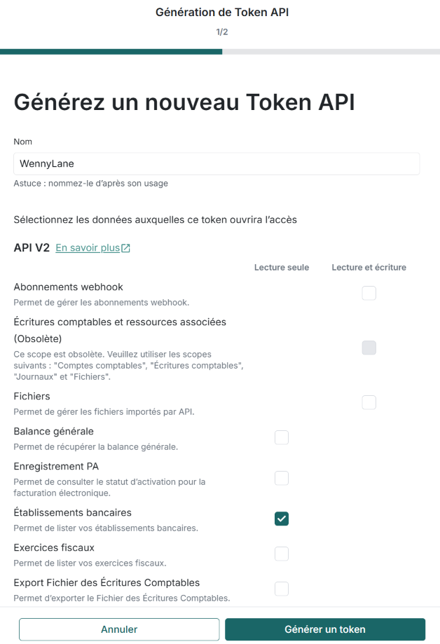
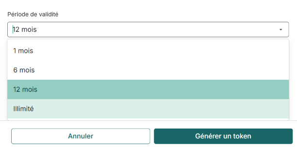
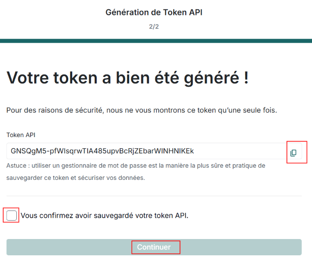

# Connectivité Pennylane

## Générer un **Token API**
Depuis la page Paramètres, Connectivité, choisissez l'onglet Développeurs puis l'action **Générer un Token API** : 

Outre **Etablissements bancaires** cochez les données suivantes en **Lecture seule** :
* Établissements bancaires
* Catégories
* Comptes bancaires
* Transactions

Choisissez une **Période de validité**, puis action **Générer un token** :

Copiez le **Token API** à l'aide de l'icône correspondante et enregistrez le en lieu sûr (attention vous ne pourrez plus le réafficher).

Cochez pour confirmation, puis action **Continuer**.

## Remarques

* Un **Token API** est propre à une société.\
  Il faudra donc en générer un pour chacune d'elles le cas échéant.
* A l'issu de la **Période de validité** définie ci-dessus, un nouveau token devra être généré (en veillant à lui accorder les mêmes autorisations) et reporté dans Business Central.

